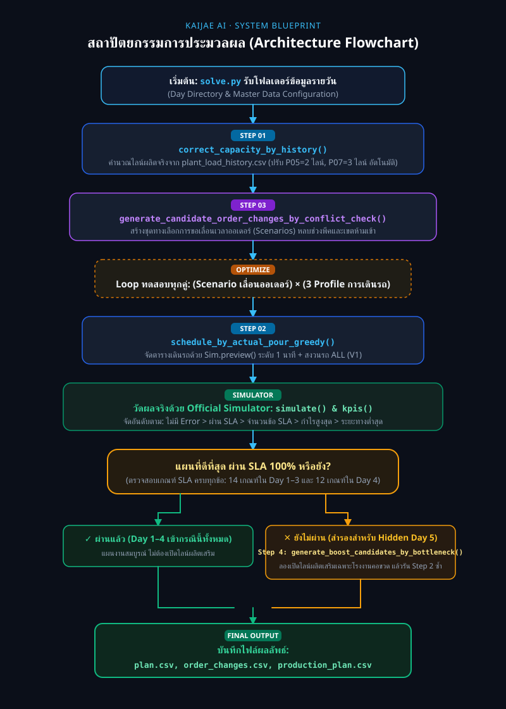

# ระบบจัดตารางผลิตและเดินรถโม่คอนกรีต — ทีม KAIJAE AI (ไก่แจ้เอไอ)



คลังโค้ดชุดส่งมอบจริงจากงานแข่งขัน **AI Hackathon Route Optimization 2026: AI for Green Logistics** จัดโดยคณะวิศวกรรมศาสตร์ มหาวิทยาลัยกรุงเทพ ร่วมกับ SCG และ CPAC (วันที่ 17 ตุลาคม 2569)

* **ทีม:** KAIJAE AI (ไก่แจ้เอไอ)
* **ผลการแข่งขัน:** ผ่านเข้ารอบ 5 ทีมสุดท้าย และได้รับ **รางวัลชมเชย ระดับมัธยมศึกษา**

---

## บทบาทและความรับผิดชอบของเจ้าของผลงาน

ในการแข่งขันครั้งนี้ ผมเริ่มต้นจากพื้นฐานที่ยังไม่ถนัดการเขียนโปรแกรมด้วยตัวเอง จึงรับหน้าที่หลักในส่วนการ **ควบคุมและตรวจสอบการทำงานของ AI** ควบคู่กับการสื่อสารผลงาน:

1. **คุมทิศทางและตรวจสอบแผนงาน (ควบคุมผลลัพธ์กับกติกาจริง)**
   * อ่านและทบทวนแผนการจัดตารางเดินรถที่ AI เสนอ ตรวจสอบความสมเหตุสมผลระหว่างต้นทุนการผลิต ระยะทางขนส่ง และความเสี่ยงหน้างานของลูกค้าแต่ละระดับ
   * สั่งให้ AI ทดสอบรันแผนผ่านตัวจำลองกติกาจริงของผู้จัด (`aiconcrete.py`) จนมั่นใจว่าผลลัพธ์ในชุดฝึกซ้อมทั้ง 4 วันผ่านเกณฑ์ความตรงต่อเวลาและความต่อเนื่องครบทุกข้อโดยไม่เกิดข้อผิดพลาด ก่อนกดบันทึกและจัดเตรียมไฟล์ส่งงาน
2. **ผู้นำเสนอหลัก (Pitching) และการตอบคำถาม**
   * เป็นตัวแทนหลักนำเสนอภาพรวมระบบ แนวคิดการแก้ปัญหา และหน้าจอแสดงผลสำหรับฝ่ายปฏิบัติการต่อคณะกรรมการจากมหาวิทยาลัยกรุงเทพ, SCG และ CPAC รวมถึงร่วมตอบคำถามกับเพื่อนในทีม
3. **นำความรู้กลับมาศึกษาต่อยอด**
   * หลังจบการแข่งขันได้นำทั้งแนวคิดการแก้ปัญหาเชิงโลจิสติกส์และโครงสร้างโค้ด Python ชุดนี้กลับมาศึกษาต่อด้วยตัวเอง เพื่อทำความเข้าใจตรรกะการคำนวณ การตรวจสอบความถูกต้องของข้อมูล และการตัดสินใจทางธุรกิจ

---

## โจทย์ธุรกิจและจุดสำคัญที่ค้นพบจากข้อมูล

โจทย์ให้วางแผนจัดส่งคอนกรีตผสมเสร็จของบริษัทจำลอง (`AI Concrete`) ประจำวัน โดยต้องตัดสินใจเลือก **โรงงานที่โหลด · รถโม่ที่ใช้ · เวลาเริ่มผสม** เพื่อให้ลูกค้าทั้ง 7 ระดับได้รับสินค้าตรงเวลาและเทต่อเนื่องไม่เกิดรอยต่อคอนกรีต (Cold Joint) พร้อมทำกำไรสุทธิสูงสุด และลดระยะทางกับการปล่อยคาร์บอน

จากการตรวจสอบข้อมูลข้ามตารางก่อนวางแผน พบเงื่อนไขสำคัญ 3 เรื่องที่ทำให้แผนเดิมของพนักงานและโค้ดตั้งต้นไม่ผ่านเกณฑ์:

1. **กำลังการผลิตในระบบไม่ตรงกับหน้างานจริง:**
   ในไฟล์ตั้งค่า `plants.csv` ระบุว่าโรงงานบางนา (`P05`) มี 3 ไลน์ และตลิ่งชัน (`P07`) มี 2 ไลน์ แต่เมื่อตรวจกับบันทึกฝ่ายผลิตและประวัติการโหลดย้อนหลัง (`plant_load_history.csv`) พบว่า `P05` ปิดซ่อมไลน์ที่ 3 เหลือ **2 ไลน์จริง** (โหลดสูงสุด 10 เที่ยว/ชั่วโมง) ส่วน `P07` ติดตั้งไลน์ที่ 3 ใช้งานแล้วเป็น **3 ไลน์จริง** (โหลดสูงสุด 12 เที่ยว/ชั่วโมง)
2. **ข้อจำกัดการวิ่งข้ามโรงงานของรถโม่ 76 คัน:**
   กองรถแบ่งเป็นรถใหญ่ 54 คัน และรถเล็ก 22 คัน โดยมีรถกลุ่ม `V1` ที่เข้าได้ทุกโรงงานเพียง **22 คัน** (รถใหญ่ 16 คัน, รถเล็ก 6 คัน) ส่วนอีก 54 คันถูกจำกัดสิทธิ์โรงงาน (`V2` 41 คัน สำหรับ `P01|P02|P03|P07` และ `V3` 13 คัน สำหรับ `P04|P05|P06|P08`) โรงงานฝั่งใต้และตะวันออกเฉียงใต้มีรถใหญ่ประจำโซน (`V3`) เพียง 7 คัน จึงต้องมีระบบกันไม่ให้ฝั่งเหนือดึงรถ `V1` ไปใช้จนหมด
3. **ข้อจำกัดเวลาหน้างานและเหตุการณ์จราจรรายวัน:**
   แต่ละวันมีเงื่อนไขต่างกัน เช่น รถหายช่วงวันทำงาน, เขตห้ามรถบรรทุกช่วงรับส่งนักเรียนและรถติดฝั่งเหนือ-ตะวันออกในวันเปิดเทอม, ปิดถนนใจกลางเมืองและรถติดหนักช่วงเย็นวันลอยกระทง รวมถึงวันหยุดที่คนขับลาและโรงงานลดไลน์ ทำให้ต้องคัดเลือกเฉพาะลูกค้าที่ระบุเงื่อนไขยืดหยุ่นได้ (`later_ok` / `earlier_ok`) มาขอเลื่อนเวลานัดส่งอย่างถูกต้องตามกติกา

---

## แนวทางการทำงานของโค้ด (4 ขั้นตอน)

โค้ดในโฟลเดอร์ `code/` เขียนด้วยภาษา Python มาตรฐานล้วน (Python 3.9+ ไม่ใช้ไลบรารีภายนอก) แบ่งหน้าที่เป็นขั้นตอนชัดเจน ดังนี้:

1. **`step1_correct_capacity_by_history.py` — ปรับกำลังการผลิตจริงจากสถิติย้อนหลัง**
   คำนวณจำนวนไลน์ผลิตที่ทำงานได้จริงของแต่ละโรงงานย้อนกลับจากสถิติการโหลดสูงสุดต่อชั่วโมงในประวัติการทำงาน (`P05` จาก 3 เหลือ 2 ไลน์ และ `P07` จาก 2 เป็น 3 ไลน์) โดยไม่ผูกค่าตายตัวเพื่อให้ทำงานได้กับข้อมูลวันตัดสินด้วย
2. **`step3_shift_orders_by_conflict_check.py` — สร้างทางเลือกการขอเลื่อนเวลาลูกค้า (`order_changes.csv`)**
   ตรวจจับคำสั่งซื้อที่เวลานัดชนช่วงห้ามเข้าพื้นที่ หรืออยู่ในช่วงรถติดหนักจากเหตุการณ์ของวัน แล้วสร้างชุดทางเลือกการขยับเวลาเฉพาะรายที่ลูกค้าอนุญาต (`later_ok` / `earlier_ok`) และไม่เกินเพดานเวลาที่กำหนด
3. **`step2_schedule_by_actual_pour_greedy.py` — จัดคิวโรงงานและรถโม่แบบตามเวลาเทจริง**
   * ประมาณช่วงเวลามาถึงหน้างานโดยอิงเวลาเทเสร็จจริงของคันก่อนหน้า เพื่อคุมช่องว่างการเทไม่ให้เกินเกณฑ์ของแต่ละระดับลูกค้า
   * ค้นหาเวลาเริ่มโหลดละเอียดระดับ 1 นาที ผ่านตัวจำลอง `Sim.preview()` ของผู้จัด
   * ใส่ค่าถ่วงน้ำหนักสงวนรถส่วนกลาง (`V1`) ให้โรงงานที่มีรถจำกัดโซนเพียงพอเลือกใช้รถประจำโซนของตัวเองก่อน และทดลองปรับน้ำหนัก 3 รูปแบบ (`Standard Balanced`, `Proactive VIP`, `Moderate Reserve`)
4. **`step4_boost_lines_by_bottleneck.py` — ระบบสำรองเปิดไลน์ผลิตเสริม (`production_plan.csv`)**
   ทำงานเฉพาะกรณีที่แผนปกติยังไม่ผ่านเกณฑ์ความตรงต่อเวลาและความต่อเนื่อง โดยคัดเลือกเฉพาะโรงงานที่ผลิตสูตรสินค้าของงานที่ตกเกณฑ์และอนุญาตให้เปิดไลน์เพิ่มได้
5. **`solve.py` — ตัวประสานและคัดเลือกแผนที่ดีที่สุด**
   จับคู่ทางเลือกการเลื่อนเวลาและรูปแบบการจัดคิว แล้วตรวจสอบผลจริงผ่าน `simulate()` และ `kpis()` ในกรอบเวลาไม่เกิน 240 วินาที จัดอันดับตามกติกาการตัดสิน (ไม่มีข้อผิดพลาด → ผ่านเกณฑ์ครบทุกข้อ → จำนวนเกณฑ์ที่ผ่าน → กำไรสุทธิสูงสุด → ระยะทางรวมต่ำสุด) พร้อมระบบย้อนกลับไปใช้แผนพื้นฐานหากเกิดเหตุขัดข้อง

---

## ผลลัพธ์จากชุดข้อมูลฝึกซ้อม 4 วัน

ตัวเลขด้านล่างตรงกับผลลัพธ์ในโฟลเดอร์ `out/day1` ถึง `out/day4` เมื่อประเมินด้วยกำลังผลิตจริง (`P05 = 2`, `P07 = 3`) และสามารถรันซ้ำจากโค้ดในคลังนี้ได้ผลตรงกันทั้งหมด:

| วัน | เหตุการณ์ในชุดฝึกซ้อม | ผ่านเกณฑ์ SLA | คะแนนความต่อเนื่อง | กำไรสุทธิ (บาท) | ระยะทางรวม (กม.) | คาร์บอน (kg CO₂) | เที่ยวถูกปฏิเสธ / Cold Joint | เวลาคำนวณจริง |
| :--- | :--- | :---: | :---: | :---: | :---: | :---: | :---: | :---: |
| **Day 1** | วันทำงานปกติ (คนขับลาป่วย 9 คัน) | ผ่าน (14/14) | 60.0 / 60 | 598,445 | 5,804 | 5,048 | 0 / 0 | ~109 วินาที |
| **Day 2** | วันเปิดภาคเรียน (เขตโรงเรียนห้ามเข้า) | ผ่าน (14/14) | 60.0 / 60 | 401,506 | 4,264 | 3,619 | 0 / 0 | ~115 วินาที |
| **Day 3** | วันลอยกระทง (ปิดถนนใจกลางเมือง 17:00) | ผ่าน (14/14) | 60.0 / 60 | 447,045 | 4,900 | 4,233 | 0 / 0 | ~86 วินาที |
| **Day 4** | วันหยุดชดเชย (รถพร้อมใช้ 50 คัน, P03 ปิด) | ผ่าน (12/12) | 60.0 / 60 | 238,828 | 2,493 | 2,112 | 0 / 0 | ~11 วินาที |
| **รวม 4 วัน** | **ชุดฝึกซ้อมทั้งหมด (545 เที่ยว)** | **ผ่าน 4/4 วัน (54/54)** | **60.0 เต็มทุกวัน** | **1,685,824** | **17,461** | **15,012** | **0 / 0** | **ไม่เกิน 2 นาที/วัน** |

* **เปรียบเทียบกับแผนตั้งต้น (ประเมินด้วยกำลังผลิตจริงเดียวกัน):**
  * **แผนเดิมของพนักงาน (`planner_plan`):** ผ่านเพียง 1/4 วัน, กำไรสุทธิรวม 1,369,121 บาท → แผนของทีมทำกำไรเพิ่ม **+316,703 บาท**
  * **โค้ดตั้งต้นของชุดแข่ง (`baseline_greedy`):** ผ่านเพียง 1/4 วัน, กำไรสุทธิรวม 1,398,628 บาท, ระยะทางรวม 21,789 กม. → แผนของทีมทำกำไรเพิ่ม **+287,196 บาท** และลดระยะทางวิ่งลง **4,328 กม.**
  * **ค่าเปิดไลน์ผลิตเสริมทั้ง 4 วัน:** **0 บาท** (จัดสมดุลและขยับเวลางานที่ยืดหยุ่นได้โดยไม่ต้องเปิดไลน์เพิ่ม)
* **หมายเหตุเรื่องวันทดสอบลับ (Day 5):** ชุดข้อมูล Day 5 และผลคะแนนรอบตัดสินเป็นข้อมูลปิดฝั่งผู้จัด จึงไม่มีข้อมูลดิบและไฟล์ผลลัพธ์ของ Day 5 อยู่ในคลังนี้

---

## โครงสร้างไฟล์ในคลังนี้

คลังนี้คัดมาเฉพาะส่วนที่ทีมส่งมอบจริงในวันแข่งขัน (ไม่รวมไฟล์ทดลองระหว่างแข่งหรือชุดข้อมูลดิบของกติกาฝั่งผู้จัด):

```text
.
├── README.md                               # สรุปผลงาน บทบาท และผลลัพธ์สำหรับพิจารณาพอร์ตโฟลิโอ
├── APPROACH.md                             # เอกสารอธิบายแนวคิดและผลการวิเคราะห์ฉบับส่งมอบ
├── code/
│   ├── solve.py                            # โปรแกรมหลักสำหรับรันสร้างแผนรายวัน
│   ├── step1_correct_capacity_by_history.py# ขั้นตอนที่ 1: ปรับกำลังผลิตจากสถิติโหลดย้อนหลัง
│   ├── step2_schedule_by_actual_pour_greedy.py # ขั้นตอนที่ 2: จัดคิวเดินรถตามเวลาเทจริงและสงวนรถ V1
│   ├── step3_shift_orders_by_conflict_check.py # ขั้นตอนที่ 3: เลื่อนเวลาออเดอร์หลบข้อจำกัด/รถติด
│   ├── step4_boost_lines_by_bottleneck.py  # ขั้นตอนที่ 4: เปิดไลน์เสริมเฉพาะจุดคอขวด (ตัวสำรอง)
│   ├── aiconcrete.py                       # ตัวจำลองกติกาและการให้คะแนนจากชุดผู้จัด
│   ├── baseline_greedy.py                  # โค้ดตั้งต้นจากชุดผู้จัด (ใช้เป็นตัวสำรองฉุกเฉิน)
│   └── requirements.txt                    # ระบุการใช้ Python 3.9+ มาตรฐานล้วน
├── out/
│   └── day1/ ... day4/                     # ผลแผนเดินรถ (plan.csv, order_changes.csv,
│                                           # production_plan.csv, plan_loads.csv, plan_result.json)
└── viz/
    ├── dashboard.html                      # หน้าจอควบคุมและติดตามแผน (เปิดในเบราว์เซอร์ได้ทันที)
    ├── pipeline_architecture.svg           # แผนผังลำดับการทำงานของโปรแกรม
    ├── pipeline_architecture.html          # แผนผังการทำงานแบบหน้าเว็บ
    └── README.md                           # คู่มือการใช้งานหน้าจอแสดงผล
```

---

## วิธีทดสอบรันโค้ดและเปิดดูหน้าจอแสดงผล

* **เปิดดูหน้าจอแสดงผล (ไม่ต้องรันเซิร์ฟเวอร์):**
  เปิดไฟล์ `viz/dashboard.html` ด้วยเว็บเบราว์เซอร์ เพื่อดูสรุปผลทางการเงิน ตารางเกณฑ์ลูกค้า ไทม์ไลน์การจัดส่ง และตารางคิวงานสำหรับโรงงานและคนขับ (ข้อมูลผลลัพธ์ของ Day 1–4 ถูกฝังไว้พร้อมแสดงผลแบบออฟไลน์)
* **รันโปรแกรมสร้างแผนใหม่ (เมื่อมีโฟลเดอร์ชุดข้อมูลรายวันจากชุดแข่งของผู้จัด):**
  ```bash
  cd code
  python solve.py <path_to_day_dir> <path_to_out_dir>
  ```
  โปรแกรมจะสร้างไฟล์ผลลัพธ์ 3 ไฟล์ ได้แก่ `plan.csv`, `order_changes.csv` และ `production_plan.csv` ภายในโฟลเดอร์ปลายทางโดยไม่ใช้อินเทอร์เน็ต
